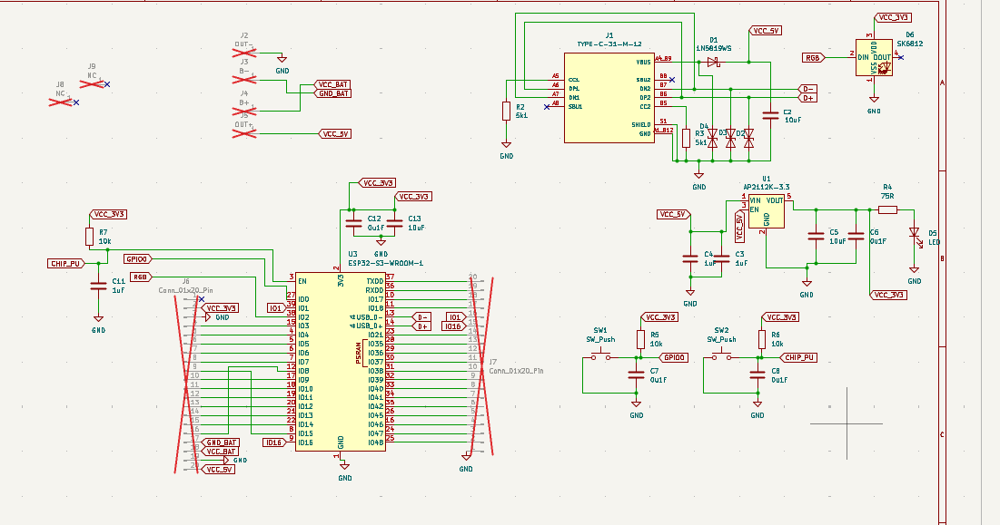
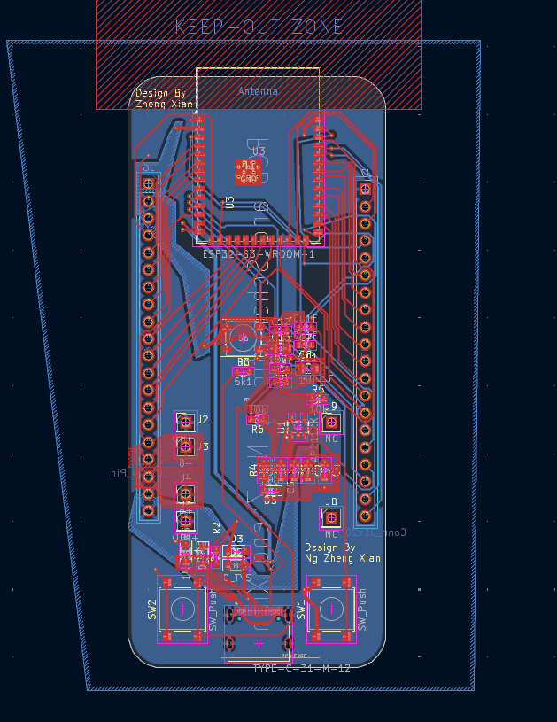
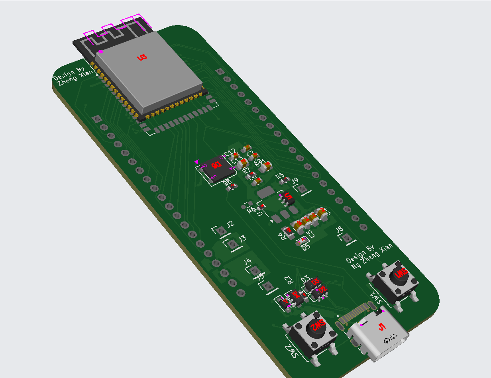

# EaSyPower32

EaSyPower32 is an ESP32-S3 development board with USB-C and a connection for a TP4056 charger module. It is designed to make battery-powered ESP32 projects easier to prototype.

## Features

- ESP32-S3-WROOM-1 module (N16R2)
- USB-C connection
- AP2112K 3.3 V regulator
- Reset and boot buttons
- Status LED and SK6812 RGB LED
- Breakout pins for connecting a TP4056 charger module

The TP4056 itself is not included on the PCB; install a compatible charger module in the board's battery-power connection.

## Design files

KiCad source files are in [`kicad files/`](kicad%20files/). The schematic and board previews are shown below.

| Schematic | PCB layout | Board view |
| --- | --- | --- |
|  |  |  |

## Manufacturing

Ready-to-upload Gerber and drill files are in [`Production Files/`](Production%20Files/). The original fabrication bundle is [`EaSyPower32_v1.zip`](Production%20Files/EaSyPower32_v1.zip). It contains the copper, solder mask, paste, silkscreen, board outline, and plated/non-plated drill files. The matching BOM and placement files are included as CSVs in the same folder.

For a new or modified board revision, open `breadESP32.kicad_pcb` in KiCad and regenerate fabrication outputs from that board before ordering. Check the board outline and manufacturer design rules against your chosen fabricator.

## BOM(from BOM.md)

| Reference(s) | Qty. | Value / description | Footprint | LCSC part |
| --- | ---: | --- | --- | --- |
| C2, C5, C13 | 3 | 10 µF capacitor | 0805 | C49678 |
| C3, C4, C11 | 3 | 1 µF capacitor | 0805 | C5199872 |
| C6, C7, C8, C12 | 4 | 100 nF capacitor | 0603 | C14663 |
| D1 | 1 | 1N5819WS Schottky diode | SOD-323 | C5451629 |
| D2, D3, D4 | 3 | TVS diode (as listed in assembly BOM) | SOD-323 | C7519 |
| D5 | 1 | Indicator LED | 0603 | C19171390 |
| D6 | 1 | SK6812 RGB LED | PLCC-4, 5 × 5 mm | C5378720 |
| J1 | 1 | TYPE-C-31-M-12 USB-C receptacle | USB-C, 16-pin | C165948 |
| R2, R3 | 2 | 5.1 kΩ resistor | 0603 | C2907044 |
| R4 | 1 | 75 Ω resistor | 0805 | C17820 |
| R5, R6, R7 | 3 | 10 kΩ resistor | 0603 | C98220 |
| SW1, SW2 | 2 | Tactile push button | SMD, B3S-1000 style | C273499 |
| U1 | 1 | AP2112K-3.3 regulator | SOT-23-5 | C51118 |
| U3 | 1 | ESP32-S3-WROOM-1-N16R2 module | ESP32-S3-WROOM-1 | C2913205 |

See [`BOM.md`](BOM.md) for the component list and LCSC part numbers. The project journal is in [`JOURNAL.md`](JOURNAL.md), and the `Firmware/` folder contains a minimal Arduino sketch.